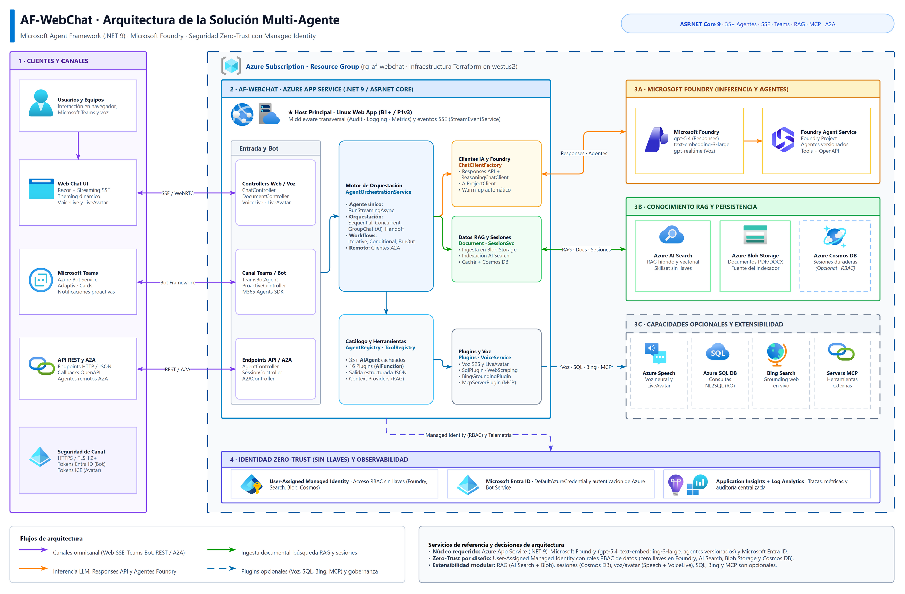
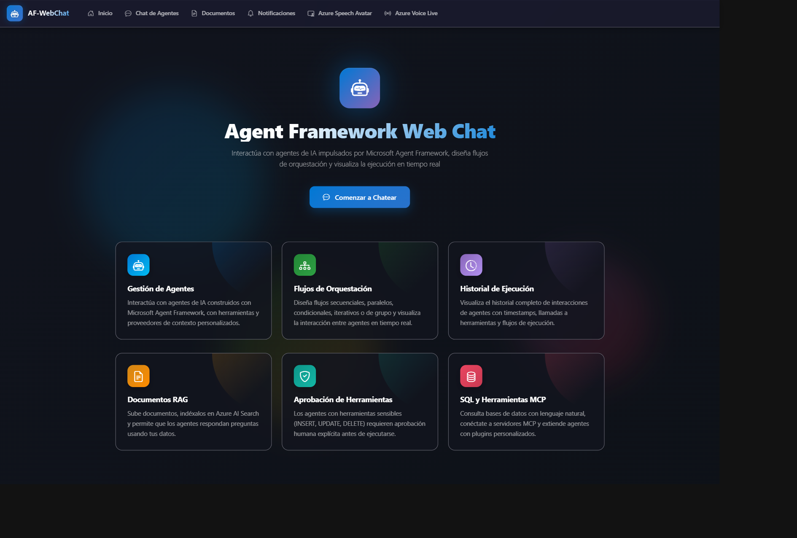
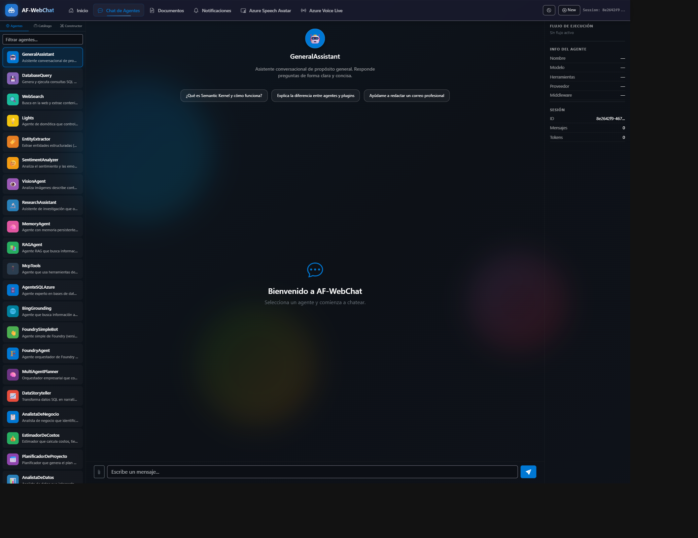
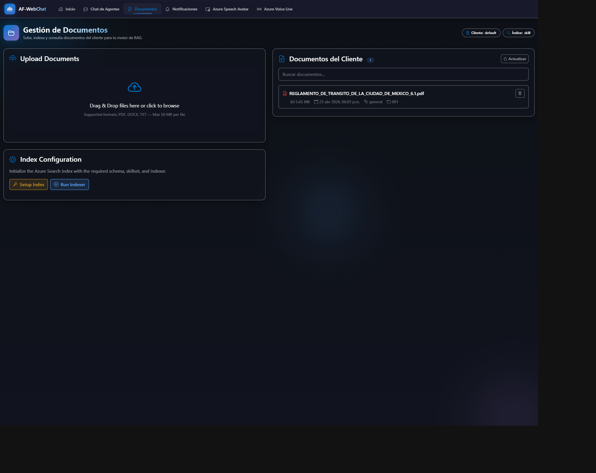
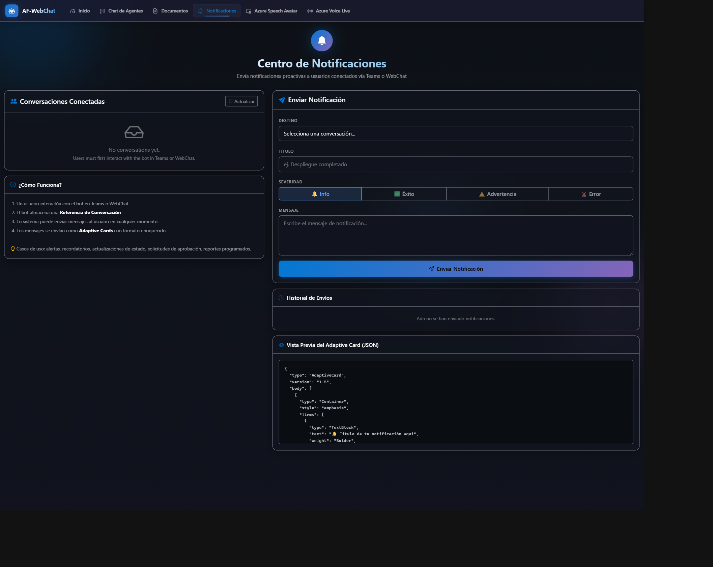
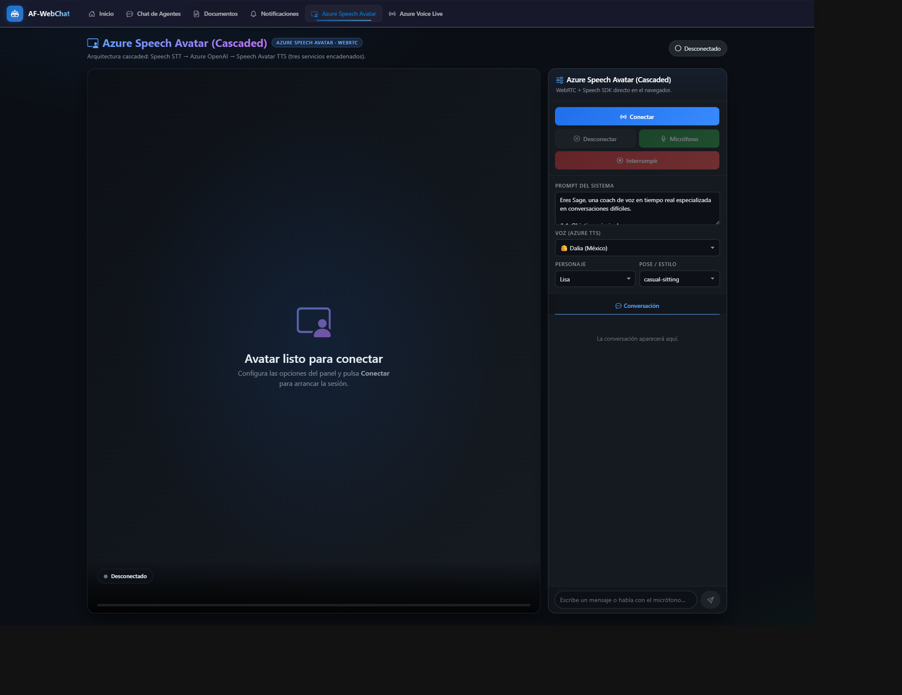
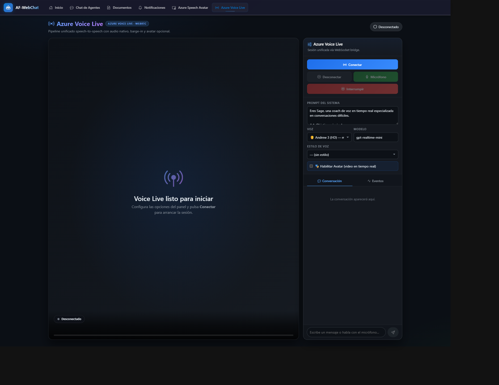

# SE-AgentFramework · AF-WebChat

[](https://dotnet.microsoft.com/download/dotnet/9.0)
[](https://github.com/microsoft/agents)
[](https://ai.azure.com)
[](02-AFWebChat/docs/TEAMS_INTEGRATION_GUIDE.md)
[](#autenticación-y-seguridad)
[](infra/)

**Plataforma de referencia empresarial para construir, orquestar y desplegar sistemas multi-agente con [Microsoft Agent Framework SDK](https://github.com/microsoft/agents) sobre Microsoft Foundry.** Combina orquestación multi-agente, workflows deterministas, RAG híbrido sin llaves, protocolo MCP/A2A, voz en tiempo real y publicación en Web y Microsoft Teams en una solución **.NET 9** lista para Azure.

[**Arquitectura**](#arquitectura-de-la-solución) · [**Vistazo a la interfaz**](#vistazo-a-la-interfaz) · [**Capacidades**](#capacidades-principales) · [**Servicios de Azure**](#servicios-de-azure-utilizados) · [**Inicio rápido**](#inicio-rápido) · [**Despliegue Terraform**](#despliegue-azure)

---

## ¿Qué es este proyecto?

**SE-AgentFramework** es una aplicación de referencia completa y funcional que muestra cómo diseñar, gobernar y operar agentes de IA en producción con el ecosistema de Microsoft. No es una librería aislada: es una **solución end-to-end** que puedes clonar, personalizar y desplegar en tu suscripción de Azure.

Demuestra de forma práctica:

- Creación de agentes con `Microsoft.Agents.AI`, **Responses API** y resumen de razonamiento en vivo (`ReasoningChatClient`)
- Orquestación multi-agente (`Sequential`, `Concurrent`, `GroupChat` con moderador IA, `Handoff`) y workflows (`Iterative`, `Conditional`, `FanOut`)
- Publicación omnicanal en **Web Chat** (streaming SSE), **Microsoft Teams** (Adaptive Cards + notificaciones proactivas) y **Microsoft Foundry** (agentes versionados)
- Integración de herramientas empresariales vía plugins nativos (`AIFunction`), **Model Context Protocol (MCP)** y agentes remotos **A2A**
- RAG híbrido y vectorial con **Azure AI Search** + **Blob Storage**, persistencia de sesiones en **Cosmos DB** y seguridad **Zero-Trust** con Managed Identity

---

## Arquitectura de la solución

[](docs/architecture/af-webchat-arquitectura.svg)

> 📐 **Recursos del diagrama:** [**Fuente editable (`.drawio`)**](docs/architecture/af-webchat-arquitectura.drawio) · [**Vectorial de alta nitidez (`.svg`)**](docs/architecture/af-webchat-arquitectura.svg) · [**Imagen de presentación (`.png`)**](docs/architecture/af-webchat-arquitectura.png)

| Zona | Rol en la arquitectura | Componentes clave |
|---|---|---|
| **1 · Clientes y Canales** | Entrada omnicanal de usuarios, equipos y agentes externos | Web Chat UI (streaming SSE, VoiceLive, LiveAvatar), Microsoft Teams (Azure Bot Service + Adaptive Cards) y endpoints REST / A2A |
| **2 · AF-WebChat (App Service)** | Host principal ASP.NET Core (.NET 9) con pipeline multi-agente | Capa de entrada y bot, `AgentOrchestrationService` (agente único, `Sequential`, `Concurrent`, `GroupChat`, `Handoff`, workflows `Iterative`/`Conditional`/`FanOut`, A2A), `AgentRegistry` (35+ agentes) y `ToolRegistry` (16 plugins) |
| **3A–3C · Servicios de Azure** | Inferencia, agentes versionados, RAG, sesiones y extensibilidad | **Microsoft Foundry** (`gpt-5.4`, `text-embedding-3-large`, `gpt-realtime`, Foundry Agent Service), **Azure AI Search** + **Blob Storage**, **Cosmos DB** (opcional) y servicios modulares (Speech, Azure SQL, Bing, MCP) |
| **4 · Identidad y Observabilidad** | Seguridad Zero-Trust sin llaves y telemetría de extremo a extremo | **User-Assigned Managed Identity** + **Microsoft Entra ID** (`DefaultAzureCredential` y RBAC de datos) y **Application Insights** + **Log Analytics** |

### Flujo de una petición

1. **Entrada omnicanal:** El usuario o sistema externo interactúa vía Web Chat (`SSE` / `WebRTC`), Microsoft Teams (`Bot Framework`) o `REST / A2A`.
2. **Enrutamiento de ejecución:** `AgentOrchestrationService` selecciona el canal de ejecución correspondiente (agente individual, patrón de orquestación multi-agente, workflow o agente remoto A2A).
3. **Inferencia y razonamiento:** Los agentes obtienen su `IChatClient` desde `ChatClientFactory` (Responses API + `ReasoningChatClient`) o invocan agentes publicados y versionados en **Microsoft Foundry**.
4. **Conocimiento y herramientas:** Durante el turno, los agentes consultan índices híbridos/vectoriales en **Azure AI Search**, persisten estado en **SessionService / Cosmos DB** e invocan plugins (`AIFunction`) hacia SQL, Bing o servidores MCP.
5. **Respuesta en tiempo real:** Los eventos de pensamiento, llamadas a herramientas y tokens (`StreamEventService`) regresan en vivo como stream **SSE** al navegador o como **Adaptive Card** a Microsoft Teams.

---

## Estructura de la solución

```
SE-AgentFramework.sln
│
├── 02-AFWebChat/                  ← Aplicación web principal (.NET 9 / ASP.NET Core)
│   ├── Agents/                       35+ agentes organizados por categoría (incl. Foundry y A2A)
│   ├── Orchestrations/               Patrones multi-agente (Sequential, Concurrent, GroupChat, Handoff)
│   ├── Workflows/                    Workflows deterministas (Iterative, Conditional, FanOut)
│   ├── Bot/                          Integración con Azure Bot Service para Microsoft Teams
│   ├── Controllers/                  Endpoints Web, SSE, Documentos, Sesiones, Voz y A2A
│   ├── Services/                     ChatClientFactory, ReasoningChatClient, SessionService, RAG
│   ├── Tools/Plugins/                16 plugins (SQL, AI Search, MCP, Bing, Web Scraping...)
│   ├── Middleware/                   Auditoría, Logging y Métricas para agentes
│   ├── Views/ & wwwroot/             UI Razor con theming unificado, SSE, VoiceLive y LiveAvatar
│   └── docs/                         Guías técnicas (Razonamiento, A2A, Teams, Avatar)
│
├── 01-AgentFrameworkTests/        ← Laboratorio didáctico en C# (00 → 13 por tema)
├── 01-AgentFrameworkTests-Python/ ← Los mismos temas en notebooks interactivos de Python
├── infra/                         ← Infraestructura como código en Terraform (Zero-Trust)
└── docs/
    ├── architecture/              ← Diagrama oficial (.drawio, .svg, .png)
    └── screenshots/               ← Capturas de interfaz de usuario
```

---

## Servicios de Azure utilizados

### Servicios principales (requeridos)

| Servicio | SKU / Modelo | Propósito en la solución | Componentes que lo usan |
|---|---|---|---|
| **Azure App Service** | B1+ / P1v3 (producción) | Hospeda la aplicación web ASP.NET Core. Es el recurso principal de cómputo donde vive la solución | Toda la aplicación (AF-WebChat) |
| **Microsoft Foundry** | Proyecto + `gpt-5.4` + `text-embedding-3-large` | Motor de inferencia, Responses API, agentes versionados y embeddings para RAG | `ChatClientFactory`, agentes Foundry y RAG |
| **Microsoft Entra ID** | — | Autenticación y autorización. Soporta `DefaultAzureCredential` para acceso sin API keys | `Azure.Identity`, Bot Framework, todos los servicios Azure |

### Servicios opcionales (habilitan funcionalidades avanzadas)

| Servicio | Propósito en la solución | Componentes que lo usan | Configuración |
|---|---|---|---|
| **Azure AI Search** | Retrieval Augmented Generation (RAG) con búsqueda semántica, vectorial e híbrida sobre documentos indexados | `AzureSearchPlugin`, `AzureSearchRAGProvider`, `DocumentIndexingService`, `LegalIndexPlugin`, `SkillIndexPlugin` | `AzureSearch:Endpoint`, `AzureSearch:IndexName` |
| **Azure SQL Database** ⚙️ | Consultas a bases de datos empresariales. Los agentes pueden explorar esquemas y ejecutar queries SELECT de solo lectura. **No se requiere si no se usan los agentes de SQL** | `SqlPlugin`, `GetSchemaPlugin`, `QuerySqlPlugin`, `EmailDataPlugin` | `ConnectionStrings:SqlServer` |
| **Azure Blob Storage** | Almacenamiento de documentos subidos por usuarios. Sirve como data source para el indexador de Azure AI Search | `BlobStorageService`, `DocumentService` | `AzureStorage:AccountName` + Managed Identity |
| **Azure Document Intelligence** | OCR y extracción inteligente de texto de PDFs, imágenes y documentos escaneados | `DocumentService` | `AzureDocumentIntelligence:Endpoint` |
| **Microsoft Foundry Project** | Publicación de agentes versionados con RBAC, trazabilidad y gestión del ciclo de vida | `FoundrySimpleBotAgent`, `FoundryOrchestratorAgent` | `AzureOpenAI:EndpointProject` |
| **Azure Cosmos DB** | Persistencia duradera de sesiones de conversación (alternativa al almacenamiento en memoria) | `SessionService` (configuración opcional) | `CosmosDB:ConnectionString`, `CosmosDB:DatabaseName` |
| **Azure Bot Service** | Canal de comunicación con Microsoft Teams. Gestiona el registro del bot, autenticación y enrutamiento de mensajes | `TeamsBotAgent`, `ConversationReferenceStore` | `Connections:ServiceConnection`, `TokenValidation` |
| **Bing Search API** ⚙️ | Grounding con búsqueda web en tiempo real. Permite a los agentes acceder a información actualizada de internet. **No se requiere si no se usa el agente BingGrounding** | `BingGroundingPlugin` | `BingSearch:ApiKey` |
| **Azure Speech Service** 🎙️ | Síntesis de voz neural y reconocimiento de voz. Usado por la página LiveAvatar para generar audio+animación del avatar en tiempo real (AvatarSynthesizer) y transcribir al usuario (SpeechRecognizer). **No se requiere si no se usa la página LiveAvatar** | `LiveAvatarController`, `live-avatar.js` | `AzureSpeech:SubscriptionKey`, `AzureSpeech:Region` |
| **Azure VoiceLive** 🎙️ | Conversaciones de voz en tiempo real. Soporta modos Full Native S2S, Cascade e Hybrid. **No se requiere si no se usa la página VoiceLive** | `VoiceLiveController`, `voice-live.js` | `VoiceLive:Endpoint`, `VoiceLive:Model` + Managed Identity |

> ⚙️ = Completamente opcional. La aplicación funciona sin este servicio; solo se necesita si se habilitan los agentes que lo consumen.
>
> 🎙️ = Funcionalidad de voz y avatar opcional. No se requiere ninguna infraestructura adicional si no se usan las páginas VoiceLive/LiveAvatar. Los recursos de Azure Speech y los deployments de modelos realtime solo son necesarios si se activan estas funcionalidades.

> 📐 **Topología de recursos en Azure:** Consulta el marco punteado **`Azure Subscription · Resource Group`** en el [diagrama de arquitectura en draw.io](#arquitectura-de-la-solución) ([`.drawio`](docs/architecture/af-webchat-arquitectura.drawio) · [`.svg`](docs/architecture/af-webchat-arquitectura.svg) · [`.png`](docs/architecture/af-webchat-arquitectura.png)), donde se detallan el host principal en **Azure App Service** y sus relaciones con **Microsoft Foundry**, datos RAG y capacidades opcionales desplegadas vía Terraform (`infra/`).

### Autenticación y seguridad

Foundry, Azure AI Search, Blob Storage y VoiceLive usan Microsoft Entra ID:

| Modo | Configuración | Recomendación |
|---|---|---|
| **DefaultAzureCredential** | Desarrollo con `az login`; Azure con la UAMI indicada por `AZURE_CLIENT_ID` | ✅ Predeterminado |
| **API Key** | Solo Azure Speech para emitir tokens de navegador/ICE de Live Avatar | Excepción temporal y acotada |

La autenticación con Bot Framework (Teams) usa **Microsoft Entra ID** con `ClientId`, `ClientSecret` y `TenantId` configurados en la sección `Connections`.

---

## Vistazo a la interfaz

La aplicación incluye seis páginas principales, todas con un sistema de theming unificado vía `--app-*` tokens (un solo cambio en `appsettings.json → AppBranding` recolorea toda la UI).

### Home — Landing page

Hero con gradiente del color de acento del cliente + 6 feature cards con glassmorphism y animación de entrada escalonada.



### Chat de Agentes

Selector de agentes, streaming SSE en tiempo real, soporte de markdown y syntax highlight para código.



### Documentos (RAG)

Drag & drop con metadata (Expediente, Documento, Tipo), subida a Azure Blob Storage, indexación en Azure AI Search y administración del índice. Iconos coloreados por tipo de archivo (PDF / Word / TXT).



### Centro de Notificaciones

Envía notificaciones proactivas (Adaptive Cards) a usuarios conectados en Teams o WebChat. Severidad coloreada por chip e historial con barra lateral por nivel.



### Azure Speech Avatar (Cascaded)

Pipeline cascaded: Speech STT → Azure OpenAI → Speech Avatar TTS. Soporta Full body (3D) y Talking Heads (vasa-1). Render del avatar vía WebRTC.



### Azure Voice Live

Speech-to-speech unificado con `gpt-realtime-mini` (Whisper-1 para transcripción del usuario). Avatar opcional, barge-in, catálogo de voces (S2S OpenAI, Azure HD, multilingüe, español) y centro de eventos en vivo.



---

## Capacidades principales

### Agentes de IA (35+)

| Categoría | Agentes | Descripción |
|---|---|---|
| **Básico** | GeneralAssistant, Translator, Summarizer | Conversación general, traducción, resúmenes |
| **Herramientas** | DatabaseQuery, WebSearch, Lights, Weather, FileManager | Agentes con tool-calling (function calling) |
| **Dominio** | SqlAzure, LegalAdvisor, CodeReviewer, BingGrounding, AzureSearch | Especializados con conocimiento de dominio |
| **Empresarial** | MultiAgentPlanner, DataStoryteller | Orquestadores que combinan SQL + RAG + Web |
| **Structured Output** | EntityExtractor, SentimentAnalyzer | Salida JSON estructurada |
| **Multimodal** | Vision | Análisis de imágenes con GPT-4o |
| **Composite** | ResearchAssistant | Investigación multi-paso |
| **MCP** | McpTools | Herramientas vía Model Context Protocol |
| **Foundry** | FoundrySimpleBot, FoundryOrchestrator | Agentes publicados en Azure AI Foundry |
| **Approval** | DataModifier | Agente con aprobación humana antes de ejecutar |
| **Workflow** | 17 agentes especializados | Colaboran en orquestaciones de negocio |

### Patrones de orquestación

| Patrón | Tipo | Descripción |
|---|---|---|
| **Sequential** | Orchestration | Agentes se ejecutan uno tras otro, pasándose el contexto |
| **Concurrent** | Orchestration | Agentes se ejecutan en paralelo |
| **GroupChat (Round-Robin)** | Orchestration | Agentes discuten por turnos como en una junta |
| **GroupChat (AI Moderator)** | Orchestration | Un LLM decide quién habla según el contexto |
| **Handoff** | Orchestration | Un agente delega a otro dinámicamente |
| **Iterative** | Workflow | Writer↔Reviewer loop hasta aprobación |
| **Conditional (Switch)** | Workflow | Clasificador IA enruta al agente correcto |
| **FanOut** | Workflow | Ejecución paralela + síntesis |

### Canales de publicación

| Canal | Tecnología | Características |
|---|---|---|
| **Web Chat** | ASP.NET + SSE | Streaming en tiempo real, theming, markdown |
| **Microsoft Teams** | Bot Framework + Adaptive Cards | Cards interactivas, notificaciones proactivas |
| **Azure AI Foundry** | `Azure.AI.Projects` SDK | Agentes versionados con RBAC y trazabilidad |
| **REST API** | HTTP endpoints | Integración con cualquier cliente |
| **VoiceLive** 🎙️ | Azure VoiceLive + WebSocket + WebRTC | Conversación de voz en tiempo real con GPT-4o Realtime. Tres modos: Full Native S2S, Cascade, Hybrid. Avatar animado opcional vía WebRTC |
| **LiveAvatar** 🎙️ | Azure Speech SDK + WebRTC | Avatar parlante con síntesis neural. Reconocimiento de voz en navegador + AvatarSynthesizer. Siempre en modo Cascade |

> 🎙️ = Canales de voz opcionales. Requieren Azure Speech Service y/o modelos GPT-4o Realtime. No afectan el funcionamiento de los demás canales.

### 🎙️ Voz en tiempo real (opcional)

La aplicación incluye **dos páginas de conversación de voz** que son **completamente opcionales**. Tanto las funcionalidades como la infraestructura de Azure que requieren solo son necesarias si se desea habilitar estas experiencias.

#### Páginas disponibles

| Página | Controlador | Script | Descripción |
|---|---|---|---|
| **VoiceLive** | `VoiceLiveController` | `voice-live.js` | Conversación de voz bidireccional con GPT-4o Realtime vía WebSocket. Audio PCM16 a 24kHz. Avatar animado opcional vía WebRTC |
| **LiveAvatar** | `LiveAvatarController` | `live-avatar.js` | Avatar parlante con Azure Speech SDK en navegador. `SpeechRecognizer` (STT) + `AvatarSynthesizer` (TTS + animación). Siempre modo Cascade |

#### Modos de procesamiento de voz (VoiceLive)

| Modo | Voces | Flujo | Descripción |
|---|---|---|---|
| **Full Native S2S** | `alloy`, `coral`, `shimmer`, etc. | Audio → GPT-4o → Audio | El modelo procesa audio nativamente sin STT/TTS externo. Latencia más baja |
| **Cascade** | `es-MX-DaliaNeural`, etc. | Audio → STT → LLM → TTS → Audio | Pipeline completo Speech-to-Text → LLM → Text-to-Speech. Voces neurales de Azure |
| **Hybrid** | `DragonHDLatestNeural`, etc. | Audio nativo → LLM → TTS HD → Audio | Input nativo del modelo, salida con voces HD de Azure. Mejor calidad de voz |

#### Infraestructura requerida (solo si se usan)

| Recurso | Para qué | Configuración |
|---|---|---|
| **Azure Speech Service** | STT/TTS para LiveAvatar; voces Cascade/Hybrid en VoiceLive | `AzureSpeech:SubscriptionKey`, `AzureSpeech:Region` |
| **Deployment GPT-4o Realtime** | Modelo realtime para VoiceLive | `VoiceLive:Endpoint`, `VoiceLive:ApiKey`, `VoiceLive:Model` |
| **GPU de avatar** (Azure) | Renderizado del avatar animado en la nube | Incluido en Azure Speech (avatar feature) |

> **Nota:** Si no se configuran las claves `AzureSpeech:SubscriptionKey` y `VoiceLive:ApiKey`, las páginas de voz simplemente no estarán disponibles. El resto de la aplicación (Web Chat, Teams, API, agentes) funciona con normalidad sin estos servicios.

---

## Requisitos

| Componente | Mínimo | Notas |
|---|---|---|
| **.NET SDK** | 9.0+ | |
| **Microsoft Foundry** | Proyecto con deployment `gpt-5.4` | Endpoint de cuenta + endpoint de proyecto + `DefaultAzureCredential` |
| **Node.js** | 18+ | Solo si usas MCP Server |
| **Azure Bot** | | Solo si publicas en Teams |

### Servicios opcionales

| Servicio | Para qué |
|---|---|
| Azure AI Search | RAG (Retrieval Augmented Generation) |
| Azure SQL Database | Agentes de consulta SQL |
| Azure Blob Storage | Subir y procesar documentos |
| Azure Document Intelligence | OCR y extracción de documentos |
| Bing Search API | Grounding con búsqueda web |
| Azure AI Foundry | Publicar agentes como servicio |
| Azure Cosmos DB | Persistencia de sesiones (opcional) |
| Azure Speech Service 🎙️ | Voz y avatar para LiveAvatar (STT + TTS + avatar animado) |
| Azure VoiceLive 🎙️ | Conversación de voz en tiempo real con GPT-4o Realtime (página VoiceLive) |

---

## Inicio rápido

Hay dos formas de lanzar el proyecto:

| Modo | Cuándo | Tiempo |
|---|---|---|
| 🖥️ **Local** | Desarrollo / debug | ~2 min |
| ☁️ **Azure (Terraform)** | Demo / producción | ~15 min |

---

### 🖥️ Modo local

#### 1. Clonar el repositorio

```bash
git clone https://github.com/JordanReyesLeger/agent-framework-web-chat.git
cd agent-framework-web-chat
```

#### 2. Configurar endpoints locales

Crea `02-AFWebChat/appsettings.Development.json` (ya está en `.gitignore`):

```json
{
  "AzureOpenAI": {
    "Endpoint": "https://tu-recurso.cognitiveservices.azure.com/",
    "EndpointProject": "https://tu-recurso.services.ai.azure.com/api/projects/tu-proyecto",
    "ChatDeployment": "gpt-5.4",
    "EmbeddingDeployment": "text-embedding-3-large"
  }
}
```

La aplicación usa `DefaultAzureCredential`; la identidad local necesita **Cognitive Services OpenAI User** y **Foundry User** en el proyecto.

#### 3. Ejecutar

```bash
cd 02-AFWebChat
dotnet run
```

Abre `https://localhost:5001/Home/Chat` en tu navegador.

---

<a id="despliegue-azure"></a>
### ☁️ Modo Azure (deploy completo con Terraform)

El folder [infra/](infra) contiene un stack Terraform administrable con `azd`: Web App, cuenta `AIServices`, proyecto Foundry, modelos, AI Search, Storage, Cosmos, Speech, VoiceLive, Bot Service y observabilidad.

#### Pre-requisitos

| Componente | Notas |
|---|---|
| **Azure CLI** | `az login` con la suscripción destino |
| **Terraform** | `>= 1.5` |
| **PowerShell 7** | Solo para inyectar la excepción de clave de Azure Speech usada por Live Avatar |
| **.NET SDK 9** | Para `dotnet publish` |

#### 1. Configurar `terraform.tfvars`

```pwsh
cd infra
Copy-Item terraform.tfvars.sample terraform.tfvars
```

Edita `terraform.tfvars` y rellena al menos:

```hcl
subscription_id = "<tu-subscription-id>"
```

Todas las demás variables tienen defaults sensatos. Las features opcionales (AI Search, Speech, AI Services, Cosmos, Bot Service) están todas habilitadas por defecto.

> **Notas de quota / policy:**
> - La región predeterminada es `eastus2`; valida cuota antes de provisionar.
> - SQL Database está deshabilitado por defecto porque varias suscripciones MCAPS lo bloquean por policy. Si tu suscripción lo permite, habilita `enable_sql_database = true` y define `sql_admin_password`.
> - Foundry, Search, Storage y VoiceLive tienen autenticación local deshabilitada y usan RBAC. Azure Speech mantiene una excepción acotada para Live Avatar.
> - Si conservas estados de otra suscripción, crea y selecciona un workspace nuevo antes de ejecutar `plan`.

#### 2. Provisionar infraestructura

```pwsh
terraform init
terraform apply -auto-approve
```

El plan actual crea **37 recursos** desde un estado vacío, incluyendo la cuenta/proyecto Foundry, dos deployments, UAMI y roles keyless para Search/Storage. Salidas relevantes:

```
web_app_url     = "https://app-afweb-dev-<suffix>.azurewebsites.net"
web_app_name    = "app-afweb-dev-<suffix>"
resource_group_name = "rg-afweb-dev-<suffix>"
```

#### 3. Deployar el código de la app

Desde la raíz del repo:

```pwsh
# Publish
cd 02-AFWebChat
dotnet publish AF-WebChat.csproj -c Release -o publish
Compress-Archive -Path publish\* -DestinationPath publish.zip -Force

# Habilitar SCM basic auth (necesario para `az webapp deploy`)
$rg  = (terraform -chdir=..\infra output -raw resource_group_name)
$app = (terraform -chdir=..\infra output -raw web_app_name)

az resource update -g $rg -n scm `
  --namespace Microsoft.Web --resource-type basicPublishingCredentialsPolicies `
  --parent "sites/$app" --set properties.allow=true --api-version 2023-12-01

# Stop / deploy / start (workaround para zip deploys en Linux Web Apps)
az webapp stop  -n $app -g $rg
Start-Sleep -Seconds 15
az webapp deploy -n $app -g $rg --src-path publish.zip --type zip
az webapp start -n $app -g $rg
```

> **¿Por qué `stop` + `deploy` + `start`?** El primer `az webapp deploy` en un Linux Web App recién creado a veces devuelve HTTP 400 mientras el deployment subyacente sí continúa. Parar el sitio antes del deploy es el truco que funciona consistentemente.

#### 4. Abrir el portal y probar el chat

Después de ~30 s para el cold start:

1. Abre `https://app-afweb-dev-<suffix>.azurewebsites.net/Home/Chat`
2. En el sidebar selecciona **GeneralAssistant**
3. Escribe un mensaje y envía — la respuesta llega streameada vía SSE

#### 5. (Opcional) Setup Index para RAG

Una vez la app responde:

1. Ve a `/Home/Documents` y haz clic en **Setup Index**, o
2. Llama a la API directamente:

```pwsh
Invoke-WebRequest -Uri "https://app-afweb-dev-<suffix>.azurewebsites.net/api/document/setup-index" -Method POST
```

> Espera ~60-90 s después del `terraform apply` para que RBAC del Search MI propague a Azure OpenAI antes de pulsar Setup Index. Si el primer intento devuelve `transientFailure`, simplemente vuelve a darle clic — la asignación ya está en place.

Esto crea el índice de Azure AI Search, el skillset (OCR + chunking + embeddings) y el indexer. Luego puedes subir documentos en la misma página y el indexer los procesará automáticamente.

#### 6. (Opcional) Destruir todo

```pwsh
cd infra
terraform destroy -auto-approve
```

Elimina los ~33 recursos. Las cuentas Cognitive Services se purgan duro (no quedan en soft-delete).

---

## Stack tecnológico

| Tecnología | Versión | Propósito |
|---|---|---|
| **Microsoft 365 Agents SDK** | 1.4.83 | Hosting de Bot Framework |
| **Microsoft.Agents.AI** | 1.0.0-rc5 | Runtime de agentes IA |
| **Microsoft.Agents.AI.Workflows** | 1.0.0-rc5 | GroupChat, WorkflowBuilder |
| **Microsoft.Agents.AI.Foundry** | 1.5.0 | Integración Microsoft Foundry |
| **Azure.AI.OpenAI** | 2.9.0 | SDK de Azure OpenAI |
| **Azure.AI.Projects** | 2.0.1 | Foundry Agent Service |
| **Azure.Search.Documents** | 12.0.0 | Azure AI Search (RAG y skillset keyless) |
| **Azure.Identity** | 1.21.0 | DefaultAzureCredential |
| **ModelContextProtocol** | 1.0.0 | MCP client para tools externos |
| **Azure.AI.VoiceLive** 🎙️ | 1.1.0-beta.3 | Conversaciones de voz en tiempo real con GPT-4o Realtime (opcional) |
| **Microsoft.CognitiveServices.Speech** 🎙️ | — | Azure Speech SDK para LiveAvatar: SpeechRecognizer + AvatarSynthesizer (opcional) |
| **AdaptiveCards** | 3.1.0 | UI rica en Teams |
| **.NET** | 9.0 | Runtime |
| **Bootstrap** | 5.3 | UI web |

---

## Configuración de secretos

El proyecto usa el patrón estándar de ASP.NET Core para separar configuración sensible:

| Archivo | Se sube al repo | Propósito |
|---|---|---|
| `appsettings.json` | ✅ Sí | Estructura base, valores por defecto (sin secretos) |
| `appsettings.Development.json` | ❌ No | Endpoints locales y la excepción de Speech; no guardes secretos de Foundry/Search/Storage |

ASP.NET Core carga `appsettings.json` primero y luego sobreescribe con `appsettings.Development.json` cuando `ASPNETCORE_ENVIRONMENT=Development`. No necesitas cambiar nada en código.

---

## Documentación adicional

| Documento | Descripción |
|---|---|
| [docs/architecture/af-webchat-arquitectura.drawio](docs/architecture/af-webchat-arquitectura.drawio) | Fuente editable en draw.io del diagrama de arquitectura (con exports [`.svg`](docs/architecture/af-webchat-arquitectura.svg) y [`.png`](docs/architecture/af-webchat-arquitectura.png)) |
| [02-AFWebChat/README.md](02-AFWebChat/README.md) | Documentación detallada del proyecto principal |
| [02-AFWebChat/docs/PROVIDERS_Y_RAZONAMIENTO.md](02-AFWebChat/docs/PROVIDERS_Y_RAZONAMIENTO.md) | Guía de proveedores (Responses API, Chat Completions, Foundry) y razonamiento en vivo |
| [02-AFWebChat/docs/PROTOCOLO_A2A.md](02-AFWebChat/docs/PROTOCOLO_A2A.md) | Integración de agentes remotos mediante el protocolo Agent-to-Agent (A2A) |
| [02-AFWebChat/THEMING.md](02-AFWebChat/THEMING.md) | Guía de personalización visual y branding |
| [02-AFWebChat/docs/TEAMS_INTEGRATION_GUIDE.md](02-AFWebChat/docs/TEAMS_INTEGRATION_GUIDE.md) | Guía paso a paso para publicar en Teams |

---

## Licencia

Este proyecto es una implementación de referencia con fines educativos y de demostración.
